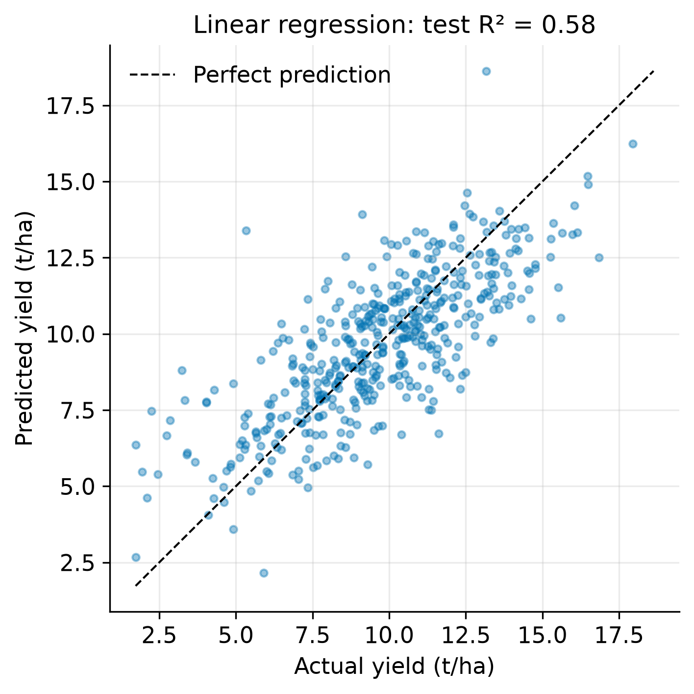
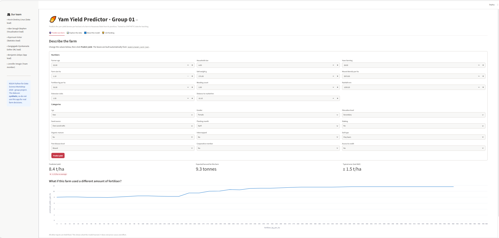
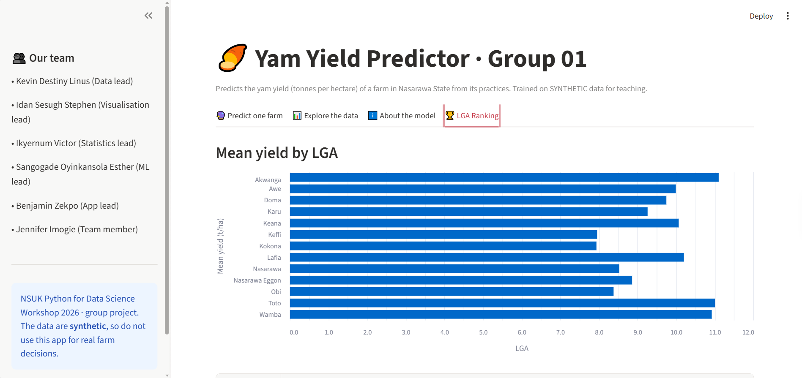

# Farm practices associated with yam yield in Nasarawa State: a reproducible data science analysis

**Group 01** · NSUK Python for Data Science Workshop 2026 · Group project

**Authors:** Kevin Destiny Linus, Idan Sesugh Stephen, Ikyernum Victor, Sangogade Oyinkansola Esther, Benjamin Zekpo, Jemimah Agbinone and Jennifer Imogie


## Abstract 
This study examined farm practices associated with yam yield using a synthetic survey representing smallholder farms across the 13 local government areas (LGAs) of Nasarawa State. Following data auditing and cleaning, 2,360 of 2,436 records were retained. Exploratory analysis, Welch's t-tests, a chi-square test, multiple regression and machine learning were used to investigate yield differences and predictive performance. Mean yield was 9.64 tonnes per hectare (t/ha). Staked farms yielded 1.62 t/ha more than non-staked farms (95% CI [1.39, 1.85], p < .001). Credit access was more common among cooperative members (41.2%) than non-members (14.6%). The regression model incorporating squared terms achieved an adjusted R² of 0.605. Linear regression was the best-performing prediction model in cross-validation and achieved a test R² of 0.578 and mean absolute error of 1.44 t/ha. Seed source, pest and disease pressure, fertiliser and staking emerged as important factors. These findings illustrate a reproducible analytical workflow rather than establish real-world agricultural effects.

## 1. Introduction and research question 
*Yam production is relevant to household food security, agricultural livelihoods and farm income. Understanding how cultivation practices, environmental conditions and access to agricultural resources relate to productivity can help identify questions worth investigating through field research. However, differences in yield may reflect several factors operating together rather than a single farming practice.

The project investigated the following research question: **Which farm practices are associated with higher yam yield among smallholder farmers in Nasarawa State?**

Three hypotheses were specified in the notebook:

- **H1:** Farms that stake their yam vines have a higher mean yield than farms that do not.
- **H2:** Cooperative members are more likely to have access to credit.
- **H3:** Mean yield differs between male and female farmers.

The analysis used synthetic data simulated for teaching, not observations collected from actual farmers. Its purpose was to demonstrate data preparation, statistical inference, predictive modelling and reproducible reporting. The results must therefore not be interpreted as estimates of actual agricultural conditions in Nasarawa State.*

## 2. Data and cleaning
### 2.1 The dataset
*The raw dataset contained 2,436 rows and 28 columns, with simulated survey years ranging from 2021 to 2025. Each row represented a farm record. The outcome was `yield_t_per_ha`, measured in tonnes per hectare, allowing productivity to be compared independently of total farm area.

Variables covered farmer demographics and resources (age, gender, education, household size, farming experience, credit and cooperative membership), cultivation practices (seed source, sett weight, mound density, planting month, staking, fertiliser, manure, intercropping and weeding), environmental conditions (soil, rainfall and pest and disease pressure), location and services (LGA, extension visits and market distance), and harvest outcomes (yield, tuber count and revenue). The repository's designated dataset documentation is [`data/README.md`](../data/README.md).*

### 2.2 Data-quality problems and how we fixed them
*The audit preceded cleaning. The raw data were preserved, and transformations were performed in Python using pandas so that the workflow could be reproduced.

| Problem | Columns | Rows affected | Fix |
|---|---|---|---|
| Exact duplicates | All | 36 | Removed duplicate records, leaving 2,400 rows. |
| Inconsistent LGA names | `lga` | 49 distinct spellings, rather than 13; row count not reported | Trimmed spaces, standardised case and mapped spelling variants to official names. |
| Inconsistent binary responses | `staking`, `organic_manure`, `intercropped`, `cooperative_member`, `access_to_credit` | Hundreds of entries; exact unique row count not reported | Trimmed spaces and mapped labels. Some single-letter responses became missing because of a mapping error. |
| Inconsistent gender labels | `gender` | 241 raw entries outside the standard Male/Female labels (from audit frequencies) | Standardised case and mapped abbreviations to Male/Female. |
| Inconsistent planting months | `planting_month` | 25 distinct labels; exact unique row count not reported | Mapped full names, abbreviations and numeric codes to five month names. |
| Non-numeric fertiliser entries | `fertilizer_kg_per_ha` | 72 missing after conversion and deduplication; three distinct text labels | Converted to numeric; invalid text became missing. |
| Currency-formatted revenue | `harvest_revenue_naira` | 612 raw entries | Removed currency symbols and commas and converted to numeric. |
| Missing-value sentinel | `rainfall_mm` | 28 raw entries | Replaced −999 with missing values. |
| Implausible measurements | `farmer_age`, `farm_size_ha`, `mound_density_per_ha`, `yield_t_per_ha` | After deduplication: 14, 9, 7 and 4, respectively | Replaced measurements outside specified valid ranges with missing values. |
| Existing missing values | Nine columns | See counts below | Retained missing predictors; removed records without valid yield. |
| Outcome leakage | `harvest_revenue_naira`, `tubers_harvested_per_ha` | All records | Excluded from pre-harvest prediction features. |

Before cleaning, missing values occurred in sett weight (145), extension visits (123), soil type (122), market distance (98), rainfall (87), farmer age (70), education (62), household size (48) and yield (39). These are column-level counts and may overlap across records.

After removing duplicates and 40 records without valid yield, the cleaned dataset contained **2,360 farms and 28 columns**, with all 13 LGAs represented and no missing outcome values. Missing predictors were not filled during cleaning because the regression used complete cases, while predictive modelling handled imputation inside its training pipeline to avoid information leakage.

One audit issue remains important: the Yes/No validation check failed because the code converted input to lowercase but retained uppercase single-letter keys in its mapping dictionary. Consequently, some valid responses were converted to missing values. The reported analyses reflect the notebook as supplied; the mapping should be corrected and the notebook rerun before treating these figures as final.*


### 2.3 Leaky variables
*Harvest revenue and tubers harvested per hectare were excluded from predictive modelling because both are known after harvest. Revenue also incorporates information related to yield. Using either variable to predict yield in advance would give the model access to information unavailable at its intended prediction time.*

## 3. Exploratory analysis 
*Across the 2,360 cleaned records, mean yield was 9.64 t/ha (SD = 2.94), with a median of 9.71 t/ha and a range of 1.50–18.70 t/ha. The middle half of yields fell between 7.71 and 11.61 t/ha. The closeness of the mean and median suggests a broadly balanced distribution.

Yield differed across LGAs. Akwanga recorded the highest simulated mean (11.10 t/ha), followed by Toto (11.00) and Wamba (10.92). Kokona (7.94) and Keffi (7.95) had the lowest means. These comparisons describe the synthetic sample and do not establish geographical effects.

Staked farms averaged 10.44 t/ha compared with 8.82 t/ha for non-staked farms. Certified seed yam had the highest mean yield (11.46 t/ha), followed by ADP/NGO seed (10.27), local market seed (9.50) and own saved setts (9.12). Figure 1 illustrates the joint descriptive patterns by seed source and staking.

![Figure 1: Mean yam yield by seed source and staking, with 95% confidence intervals]

The rainfall scatterplot and LOWESS curve indicated a hill-shaped relationship: yield was lower at both low and high rainfall levels. A simple linear correlation could therefore obscure an important nonlinear pattern. This motivated the inclusion of squared terms in the regression analysis.

The gender comparisons showed differences in both productivity and access to resources. Female farmers averaged 9.40 t/ha compared with 9.73 t/ha among male farmers. Female farmers also had smaller mean farm areas (1.13 versus 1.52 ha), fewer extension visits (0.80 versus 1.53), and lower fertiliser application (105.25 versus 110.66 kg/ha). Credit access was 13.8% among females and 29.1% among males; staking was 35.1% and 55.2%, respectively. Cooperative membership was also lower among females (28.7% versus 43.2%). These descriptive differences suggested that the unadjusted yield gap should be examined alongside farming practices and resources.

.*


## 4. Hypothesis tests 
A Welch's independent-samples t-test showed that staked farms (n = 1,145, M = 10.44, SD = 2.82 t/ha) had higher mean yield than non-staked farms (n = 1,164, M = 8.82, SD = 2.84 t/ha). The difference was 1.62 t/ha, 95% CI [1.39, 1.85], t = 13.73, p < .001, Cohen's d = 0.57. This moderate standardised difference supported H1. The test excluded 51 farms without a recorded staking category after cleaning.

**Table 1. Descriptive statistics by staking status (mean and standard deviation)**

| Variable | Non-staked M | Non-staked SD | Staked M | Staked SD |
|---|---:|---:|---:|---:|
| Yield (t/ha) | 8.82 | 2.84 | 10.44 | 2.82 |
| Fertiliser (kg/ha) | 108.45 | 85.82 | 109.24 | 90.46 |
| Farm size (ha) | 1.43 | 1.85 | 1.40 | 0.94 |
| Weeding count | 2.48 | 0.86 | 2.48 | 0.86 |
| Extension visits | 1.10 | 1.27 | 1.55 | 1.48 |

**H2: Cooperative membership and credit access**

Among 880 cooperative members with complete membership and credit information, 363 (41.2%) had credit access. Among 1,372 non-members, 200 (14.6%) had access. A chi-square test established a statistically significant association, χ²(1, N = 2,252) = 202.00, p < .001, Cramér's V = 0.30. H2 was supported. The association does not establish that joining a cooperative causes improved access to credit. The notebook did not calculate a confidence interval for Cramér's V

### H3: Gender and yam yield

Male farmers had a mean yield of 9.73 t/ha compared with 9.40 t/ha for female farmers. Welch's t-test indicated a statistically significant unadjusted difference of 0.33 t/ha, t = 2.47, p = .014, supporting H3 at the 5% significance level. The notebook did not report Cohen's d or a confidence interval for this comparison; the adjusted gender confidence interval is reported in Section 5.

An additional one-way ANOVA identified differences in mean yield across the four seed sources (F = 49.86, p < .001). This omnibus test does not establish which individual pairs differ significantly.


## 5. Regression analysis 
Ordinary least squares regression was used to examine associations with yield while holding the included predictors constant. The model incorporated fertiliser, rainfall, mound density, sett weight, weeding count, extension visits, staking, organic manure, intercropping, planting month, soil type, credit access, seed source, pest and disease level, and gender.

The initial model used 1,687 complete records out of 2,360; 673 were excluded through listwise deletion. It achieved R² = 0.532 and adjusted R² = 0.525. Table 2 presents six selected coefficients from this initial model, rather than attributing them to the later nonlinear specification.

**Table 2. Selected adjusted associations with yield in the initial regression**

| Predictor or comparison | Coefficient (t/ha) | 95% CI |
|---|---:|---|
| Certified seed versus own saved setts | 2.296 | [1.934, 2.657] |
| Staking versus no staking | 1.592 | [1.390, 1.793] |
| High versus low pest/disease pressure | −3.086 | [−3.446, −2.726] |
| Organic manure versus none | 0.855 | [0.650, 1.061] |
| Intercropping versus no intercropping | −0.699 | [−0.898, −0.501] |
| April versus March planting | −1.301 | [−1.663, −0.940] |

All six associations had p < .001. Certified seed and staking were positively associated with yield, while high pest and disease pressure showed a substantial negative association. The intercropping and planting-month estimates should be interpreted within the simulated conditions, not as general recommendations to abandon intercropping or avoid April planting.


Adding squared rainfall and mound-density terms improved adjusted R² from 0.525 to 0.605, suggesting that allowing nonlinear relationships improved model fit. The notebook did not display the squared-term coefficients successfully, so their individual signs, confidence intervals and turning points cannot be verified from the supplied outputs. The mound-density centring constant of 10 should also be reviewed against the variable's per-hectare scale.

The raw female-minus-male yield gap was −0.33 t/ha. After adjustment in the model with squared terms, the estimated difference became +0.20 t/ha (95% CI [−0.01, 0.41], p = .059). The interval includes zero, indicating insufficient evidence of an adjusted gender difference at the 5% level. This pattern is consistent with differences in measured practices and resources contributing to the raw gap, but does not demonstrate mediation or causation.

Assumption checks for the initial model included residual-versus-fitted and normal Q–Q plots. Residuals were broadly centred around zero, with some extreme observations and tail deviations. The Jarque–Bera test gave p = .060. The large condition number (1.12 × 10⁵) warrants investigation of variable scaling and possible multicollinearity. Conventional non-robust standard errors were used; formal heteroscedasticity and influence checks would strengthen the analysis.


## 6. Predicting yield with machine learning *(Member 4)*
Prediction used 23 features: 11 numerical and 12 categorical variables covering demographics, farm resources, management practices, location and environmental conditions. Farm identifiers, survey year, the target and post-harvest leakage variables were excluded. An 80:20 random split produced 1,888 training and 472 test records. Numerical variables were median-imputed and standardised, while categorical variables were imputed with their most frequent category and one-hot encoded. Preprocessing was integrated into each model pipeline.

Four models were compared using five-fold cross-validation on training data.

**Table 3. Cross-validation comparison of prediction models**

| Model | Mean R² | R² SD | Mean MAE (t/ha) |
|---|---:|---:|---:|
| Mean-prediction baseline | −0.002 | 0.002 | 2.378 |
| Linear regression | 0.626 | 0.023 | 1.435 |
| Random forest | 0.464 | 0.018 | 1.716 |
| Gradient boosting | 0.625 | 0.016 | 1.444 |

Linear regression was selected because it achieved the highest mean cross-validation R² and lowest mean MAE, although its advantage over gradient boosting was very small. On the held-out test set, it achieved R² = 0.578, MAE = 1.444 t/ha and RMSE = 1.848 t/ha. In practical terms, predictions differed from observed synthetic yields by about 1.44 t/ha on average in absolute terms. This is an average error, not a guaranteed prediction interval.



The leakage experiment demonstrated why apparently excellent prediction scores can be misleading. Adding tubers harvested per hectare to gradient boosting increased mean cross-validation R² from 0.625 to 0.874. Since tuber counts are unavailable before harvest, the improvement represents an unrealistic prediction advantage rather than evidence of a better pre-harvest model.

Permutation importance identified LGA, pest and disease level, fertiliser, staking and seed source as the leading predictive features. Shuffling these variables reduced test-set R² more than shuffling most other features. Importance describes model reliance and does not establish that intervening on a feature will cause a corresponding change in yield.


The fitted pipeline and model card were saved as `models/yam_yield_model.joblib` and `models/model_card.json` for the application.


## 7. The Streamlit app 
The project's Streamlit application is intended to make yield prediction and exploration accessible without requiring users to write Python code. The notebook confirms that the saved model and cleaned data were available to the app. Its recorded figure filenames identify prediction, data exploration, LGA ranking and dataset information tabs. Potential users include workshop participants, agricultural researchers and extension officers exploring simulated scenarios.

From the repository root, install the dependencies and start the app:

```bash
pip install -r requirements.txt
streamlit run app/streamlit_app.py
```






The screenshot filenames are recorded in the notebook, but the screenshot files and app source were not supplied with this report for independent inspection. Predictions should be restricted to conditions similar to those represented in training and should not be used as causal estimates or real-world farming advice.


## 8. Discussion and limitations 
Taken together, the simulated results identify staking, seed quality, fertiliser management and pest and disease pressure as promising subjects for further investigation. Cooperative membership was associated with credit access, while the gender comparison highlighted the importance of accounting for differences in resources and practices before interpreting productivity gaps. The nonlinear regression improvement also demonstrates the value of examining environmental relationships beyond simple linear correlations.

The principal limitation is that the data are synthetic. Moreover, the analytical design is observational in form, so associations cannot establish causal effects. Complete-case regression may be sensitive to missing-data patterns, particularly given the binary mapping issue. Unmeasured confounders, geographical clustering and model specification may influence estimates. The prediction model was evaluated on a random split from the same synthetic dataset rather than independently collected farms, so its performance cannot establish external validity. Real farm surveys, corrected cleaning, sensitivity analyses and independent validation are needed before applying the findings operationally.

## 9. Conclusion 
The analysis identified several management and environmental variables associated with simulated yam yield, notably staking, certified seed, fertiliser and pest and disease pressure. Adjusting for measured practices substantially changed the raw gender difference, while cooperative membership was associated with credit access. Linear regression provided useful predictive performance without including post-harvest leakage variables. The project demonstrates a reproducible data science workflow, but its findings require validation with real agricultural data.


## 10. What we learned as a team 
The project illustrates why data validation must precede modelling, why statistical significance should be accompanied by effect sizes, and why predictive accuracy must be evaluated without leakage. It also demonstrates the distinction between explanatory and predictive models and the importance of keeping code, data transformations, figures and reports under version control. The notebook assigns responsibilities for data cleaning, visualisation, statistics, modelling and application development, with Git and GitHub handoffs specified between stages. Individual contributions and actual commit history should be confirmed in the repository's contributions record.

---

## Appendix: reproducibility
- **Repository:** `nsuk-ds-group-01` (confirm and insert the actual GitHub repository URL before submission).
- **Run:** `pip install -r requirements.txt` → open `notebooks/group_project.ipynb` → **Restart and Run All** → `streamlit run app/streamlit_app.py`.
- **Outputs:** `data/processed/yam_survey_clean.csv`, `results/`, `figures/` and the saved model and model card.
- **AI use:** see [`docs/AI_USE_STATEMENT.md`](../docs/AI_USE_STATEMENT.md).
- **Contributions:** see [`CONTRIBUTIONS.md`](../CONTRIBUTIONS.md).
- **Source:** supplied group project notebook and its saved outputs. No external references were used.
- **Verification before submission:** correct the binary mapping, rerun the notebook and update affected results; confirm the author list (the notebook includes two additional names beyond the original report template), repository URL and screenshot links. The raw dataset, supporting project files and live app were not independently rerun or inspected for this report.
