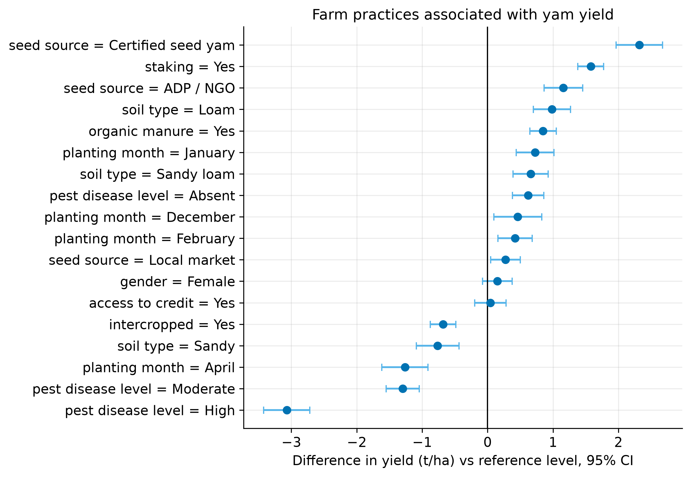
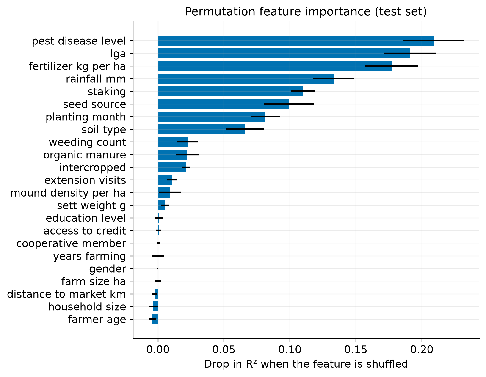

# Farm practices associated with yam yield in Nasarawa State: a reproducible data science analysis

**Group 01** · NSUK Python for Data Science Workshop 2026 · Group project

**Authors:** *Kevin Destiny Linus, Idan Sesugh Stephen, Ikyernum Victor, Sangogade Oyinkansola Esther, Benjamin Zekpo, Jennifer Imogie*

> *How to use this template: replace every line in italics with your own writing, then delete the guidance. Each
> section lists who usually drafts it, but agree this in your group. Target length: **1,500–2,500 words**, plus figures
> and tables. Every number must come from your notebook. To include a figure:*
> ``

---

## Abstract *(Member 5, written last, ~150 words)*
*In one paragraph: the question, the data (n farms, 13 LGAs, synthetic), the methods (cleaning, t-tests, chi-square, multiple regression, machine learning), the 2–3 most important results **with numbers**, and the main conclusion.*

## 1. Introduction and research question *(Member 5 or Coordinator)*
*Yam production is relevant to household food security, agricultural livelihoods and farm income. Understanding how cultivation practices, environmental conditions and access to agricultural resources relate to productivity can help identify questions worth investigating through field research. However, differences in yield may reflect several factors operating together rather than a single farming practice.

The project investigated the following research question: **Which farm practices are associated with higher yam yield among smallholder farmers in Nasarawa State?**

Three hypotheses were specified in the notebook:

- **H1:** Farms that stake their yam vines have a higher mean yield than farms that do not.
- **H2:** Cooperative members are more likely to have access to credit.
- **H3:** Mean yield differs between male and female farmers.

The analysis used synthetic data simulated for teaching, not observations collected from actual farmers. Its purpose was to demonstrate data preparation, statistical inference, predictive modelling and reproducible reporting. The results must therefore not be interpreted as estimates of actual agricultural conditions in Nasarawa State.*

## 2. Data and cleaning *(Member 1)*
### 2.1 The dataset
*The raw dataset contained 2,436 rows and 28 columns, with simulated survey years ranging from 2021 to 2025. Each row represented a farm record. The outcome was `yield_t_per_ha`, measured in tonnes per hectare, allowing productivity to be compared independently of total farm area.

Variables covered farmer demographics and resources (age, gender, education, household size, farming experience, credit and cooperative membership), cultivation practices (seed source, sett weight, mound density, planting month, staking, fertiliser, manure, intercropping and weeding), environmental conditions (soil, rainfall and pest and disease pressure), location and services (LGA, extension visits and market distance), and harvest outcomes (yield, tuber count and revenue). The repository's designated dataset documentation is [`data/README.md`](../data/README.md).*

### 2.2 Data-quality problems and how we fixed them
*The raw dataset contained 2,436 rows and 28 columns, with simulated survey years ranging from 2021 to 2025. Each row represented a farm record. The outcome was `yield_t_per_ha`, measured in tonnes per hectare, allowing productivity to be compared independently of total farm area.

Variables covered farmer demographics and resources (age, gender, education, household size, farming experience, credit and cooperative membership), cultivation practices (seed source, sett weight, mound density, planting month, staking, fertiliser, manure, intercropping and weeding), environmental conditions (soil, rainfall and pest and disease pressure), location and services (LGA, extension visits and market distance), and harvest outcomes (yield, tuber count and revenue). The repository's designated dataset documentation is [`data/README.md`](../data/README.md).*

| Problem | Columns | Rows affected | Fix |
|---|---|---|---|
| | | | |

### 2.3 Leaky variables
*Which two columns were excluded from prediction, and why?*

## 3. Exploratory analysis *(Member 2)*
*Describe the distribution of yield (mean, SD, range) and your 3–5 key findings from Part 3, each with a number. Include at least one figure. Discuss the curved rainfall relationship and what the gender comparison tables showed.*

## 4. Hypothesis tests *(Member 3)*
*Report H1 (staking, Welch's t-test), H2 (cooperative × credit, chi-square) and H3 (gender, t-test) in APA style with effect sizes and confidence intervals. Example:*
> *Farms that staked their vines had a higher mean yield than farms that did not (difference = __ t/ha, 95% CI [__, __]), Welch's t = __, p < .001, Cohen's d = __.*

*Include Table 1 (descriptive statistics by staking).*

## 5. Regression analysis *(Member 3)*
*Which variables were in the model, how many rows were used (and why fewer than the cleaned total), and the adjusted R². Interpret the 4–6 most important coefficients with their 95% CIs (direction, size, unit). Explain what the squared terms show. **Discuss the gender gap:** raw difference vs adjusted difference, and what this suggests. Include Figure 2 (coefficient plot). Mention the assumption checks.*

## 6. Predicting yield with machine learning *(Member 4)*
*Features used, train/test split, the four models compared (include Table 3 from `results/table3_model_comparison_cv.csv`), which model was chosen and why, and the test-set R², MAE and RMSE in plain words ("predictions are typically within about __ t/ha"). Explain the leakage experiment in your own words. Include Figures 3 and 4 and comment on feature importance (and why importance ≠ causation).*

## 7. The Streamlit app *(Member 5)*
*What the app does, who could use it, and how to run it. Include 2–3 screenshots. Mention its limitations (synthetic data, only valid within the ranges seen in training, not causal).*

## 8. Discussion and limitations *(everyone)*
*What do the results mean together? Which practices seem most promising for farmers or extension officers? Limitations: synthetic data; observational (association, not causation); missing data and listwise deletion in the regression; possible unmeasured confounders; model only valid for farms similar to the training data.*

## 9. Conclusion *(Member 5)*
*3–5 sentences answering the research question.*

## 10. What we learned as a team *(everyone, ~1 short paragraph each, optional but encouraged)*
*What was hard, what you would do differently, and how you used Git and GitHub together.*

---

## References
*Only cite sources you have actually read. Check every reference exists, because AI tools invent references. If you cite nothing, delete this section.*

## Appendix: reproducibility
- Repository: *link*
- Run: `pip install -r requirements.txt` → open `notebooks/group_project.ipynb` → **Run All** → `streamlit run app/streamlit_app.py`
- AI use: see [`docs/AI_USE_STATEMENT.md`](../docs/AI_USE_STATEMENT.md)
- Contributions: see [`CONTRIBUTIONS.md`](../CONTRIBUTIONS.md)
